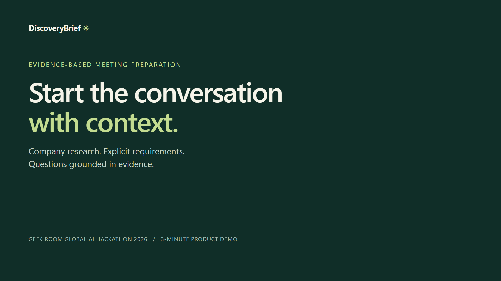
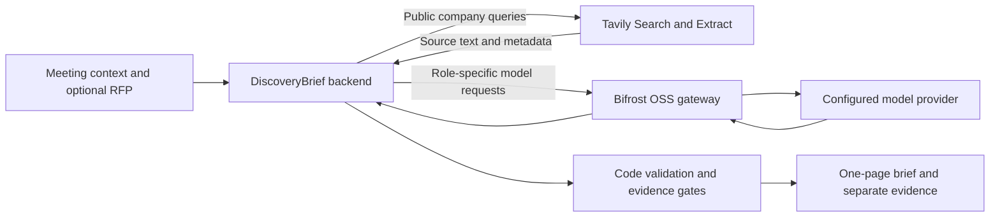

# DiscoveryBrief

**Start the conversation with context.**

DiscoveryBrief helps pre-sales engineers, solutions architects, and discovery teams prepare
for enterprise customer meetings. It combines recent company research, meeting context, and
explicit RFP requirements into a one-page brief with inspectable evidence and practical
questions to ask next.

Built for the **Geek Room Global AI Hackathon 2026**, with Tavily for public web research and
Bifrost OSS for every live model request.

## The real-world problem

Before an enterprise discovery or RFP clarification meeting, a pre-sales engineer often has
to switch between company announcements, search results, an invitation, internal notes, and
a customer's request for proposal. The preparation must answer three different questions:

- **What changed at the company?** Find relevant, recent developments and their sources.
- **What did the customer actually request?** Separate explicit requirements from assumptions.
- **What should we clarify in the meeting?** Turn missing details into useful questions.

A polished summary can obscure an old announcement, an unsupported claim, or an inferred
requirement. DiscoveryBrief keeps the supporting quotations, dates, and source links available,
and makes uncertainty visible when the evidence is insufficient.

For example, a customer requests a portal with single sign-on and integration with an existing
document repository. DiscoveryBrief records those explicit requirements and helps prepare
questions such as: Which identity provider and protocol are required? Which repository must
be integrated? What permission and synchronization behavior is expected? Public company
research adds context without treating a news announcement as proof of a technical requirement.

The intended outcome is a focused meeting agenda with a basis the team can check. Time savings
and improvements in meeting outcomes have not yet been independently measured.

## Watch the three-minute demo

[](https://www.youtube.com/watch?v=lTUKSxRqjq4)

**Click the preview to open the video.**
[Watch on YouTube](https://www.youtube.com/watch?v=lTUKSxRqjq4)

The 3:00 Full HD video uses English synthetic narration and captions. It shows an actual
public-company live result with fictional meeting/RFP context; the research wait is edited
out and labelled. A separate, labelled synthetic replay demonstrates missing public evidence.
Its original Indonesian report text is retained. See [video provenance](submission/video/README.md).

The preview and video link open the demo on YouTube. The original MP4 remains available
in [the repository](submission/video/DiscoveryBrief-demo-3min-en.mp4).

## Features

| Feature | What it does |
|---|---|
| Meeting context | Accepts company name/domain, meeting date and IANA timezone, goal, type, public research topics, and optional participants/notes. |
| Recent company research | Uses Tavily Search and Extract, including an official-domain search when a domain is supplied. Checks source identity, dates, and duplicates. |
| RFP clarification | Accepts plain-text RFP excerpts and grounds accepted requirement summaries in exact quotations and character offsets. |
| Evidence-backed findings | Retains source URLs, literal quotations, retrieval/publication metadata, and model reviews for inspection. |
| Discovery questions | Produces priority questions, tentative hypotheses, and explicit unknowns, grounded in approved material. |
| Visible uncertainty | Uses `ready`, `limited`, or `context_only` coverage labels. Ambiguous company identity can stop the run with `needs_input`. |
| One-page exports | Produces PDF, HTML, Markdown, and JSON, with separate detailed evidence and operational trace exports. |
| Bilingual experience | English is the default interface and new-report language; Indonesian remains selectable. Saved samples retain their original language. |
| Run controls | Shows progress and elapsed time, supports cancellation, and persists runs locally with bounded queue/call budgets. |
| Model fallback | Sends the configured fallback through Bifrost and records resolved-model metadata when available. |
| Reproducible demos | Includes synthetic fixtures, saved replays, and fixed-evidence evaluation cases with distinct mode labels. |

PDF layout can select fewer displayed findings to keep the page readable; the approved ledger
remains available in JSON/evidence. A PDF failure leaves the other formats usable.

## How Bifrost and Tavily are used

### Bifrost: the model gateway

[Bifrost OSS](https://github.com/maximhq/bifrost) is an AI gateway that exposes a unified,
OpenAI-compatible interface for model providers. DiscoveryBrief sends live inference requests
to the local gateway, which forwards them to the configured external provider.
[Official gateway documentation](https://docs.getbifrost.ai/quickstart/gateway/setting-up).

DiscoveryBrief uses Bifrost for five bounded roles:

1. **Planner:** chooses research directions using public company context only.
2. **Analyst:** proposes developments and extracts explicit requirements.
3. **Verifier:** checks claim support and whether requirement summaries follow from the RFP.
4. **Composer:** organizes approved material into the brief and discovery questions.
5. **Premise Auditor:** checks assumptions in the proposed questions.

These are distinct instructions and contexts in an application-controlled workflow. They
initially share the configured model. Models submit structured `submit_payload` results,
which DiscoveryBrief validates; they do not execute arbitrary tools or shell commands.

`MODEL_PRIMARY` and optional `MODEL_FALLBACK` configure routing. The pinned gateway version
is **v1.5.0**. Recovery from an unavailable primary to the configured fallback model
was observed on Windows and in Compose. Both models use the same provider in that setup;
this does not demonstrate recovery from a whole-provider outage or establish fallback quality.

The application records available usage, duration, requested/resolved model, and correlation
metadata. Missing failed-attempt usage and monetary cost remain unknown. The gateway is a
transport/routing component; factual checks belong to the DiscoveryBrief workflow and still
require human review.

### Tavily: public web research

Tavily provides web search and content extraction APIs. DiscoveryBrief uses:

- **[Tavily Search](https://docs.tavily.com/documentation/api-reference/endpoint/search):**
  finds relevant pages, URLs, snippets, and available publication metadata. The adapter uses
  advanced search, up to five results per query, a research date window, and an official-domain
  restriction for the official-news query.
- **[Tavily Extract](https://docs.tavily.com/documentation/api-reference/endpoint/extract):**
  retrieves selected page text, in batches of up to five URLs in this application, so claims
  can point to literal source quotations. Per-URL failures remain visible.

Search results are candidate evidence. DiscoveryBrief checks identity, temporal eligibility,
duplicates, quote spans, and model-assisted support before admitting a public claim. Search
ranking and publication metadata do not guarantee truth or freshness.

Queries are constructed from allowlisted public company fields and selected research topics.
**RFP text, meeting notes, raw meeting goals, and participant names never become public search
queries.** Later model roles can process that context through Bifrost and the configured provider.
Tavily is called directly by the backend adapter; it is not routed through Bifrost.



The backend uses Python, FastAPI, Pydantic, and SQLite. The frontend uses Vite and TypeScript;
Jinja and Playwright/Chromium render reports. See [architecture](docs/architecture.md).

## Quickstart: try the synthetic demo without API keys

Requirements: Python 3.11+, Node.js 20.19+ or 22.12+, and [uv](https://docs.astral.sh/uv/).
Commands below use PowerShell and run from the repository root.

```powershell
git clone https://github.com/setiani/DiscoveryBrief.git
Set-Location DiscoveryBrief

uv sync --extra dev --extra pdf --frozen
uv run playwright install chromium
npm --prefix web ci
npm --prefix web run build

$env:DISCOVERYBRIEF_MODE = 'public_demo'
$env:RESEARCH_MODE = 'fixture'
$env:ENABLE_LIVE_RUNS = '0'
uv run uvicorn discoverybrief.api.main:app --host 127.0.0.1 --port 8000 --workers 1
```

Open **http://127.0.0.1:8000/** and select a synthetic sample. This mode uses approved saved
results and does not make new Tavily or model calls. Ctrl+C stops the server.

## Run live company research

From an installed checkout, create `.env` only if it does not already exist:

```powershell
if (-not (Test-Path .env)) { Copy-Item .env.example .env }
```

Configure these values in `.env`:

| Setting | Purpose |
|---|---|
| `TAVILY_API_KEY` | Authenticates public Search and Extract calls. |
| `MODEL_PROVIDER_BASE_URL` | HTTPS endpoint of the chosen OpenAI-compatible model provider. |
| `MODEL_PROVIDER_API_KEY` | Provider credential used by the gateway. |
| `MODEL_PRIMARY` | Exact provider model ID; supports the structured role requests. |
| `MODEL_FALLBACK` | Optional fallback model ID on the configured provider. |
| `BIFROST_BASE_URL` | Local gateway URL; native default is `http://127.0.0.1:8080/v1`. |

Credentials stay in the ignored `.env`, never in frontend variables or demo files.
The adapter adds the `custom/` gateway prefix to model IDs when needed. Provider model IDs
can themselves contain a slash. `BIFROST_BASE_URL` identifies the gateway, whereas
`MODEL_PROVIDER_BASE_URL` identifies the upstream provider.

In terminal 1, install the pinned launcher once and start Bifrost:

```powershell
npm install --no-save --prefix data/bifrost-runtime @maximhq/bifrost@1.6.3
uv run python scripts/start_bifrost.py
```

The npm launcher version and gateway transport version are separate; the script pins
transport **v1.5.0** and binds the gateway to loopback port 8080.

In terminal 2, from the repository root:

```powershell
$env:DISCOVERYBRIEF_MODE = 'local'
$env:RESEARCH_MODE = 'live'
$env:ENABLE_LIVE_RUNS = '1'
$env:BIFROST_BASE_URL = 'http://127.0.0.1:8080/v1'
uv run uvicorn discoverybrief.api.main:app --host 127.0.0.1 --port 8000 --workers 1
```

Open **http://127.0.0.1:8000/**, enter a real company/domain and a future meeting time, then
create a brief. Live creation can incur Tavily and model-provider charges. The environment
settings above apply to their terminal; they override `.env`. Restart the gateway when
changing provider settings, and restart the backend when changing its configuration.

### Containers

Compose provides the app and an optional `live` Bifrost service. After installing Python
dependencies and preparing `.env`, the tested Podman workflow is:

```powershell
uv run python scripts/start_bifrost.py --prepare-only
$env:DISCOVERYBRIEF_MODE = 'local'
$env:RESEARCH_MODE = 'live'
$env:ENABLE_LIVE_RUNS = '1'
podman build --format docker -t discoverybrief-app .
podman compose --profile live up -d --no-build
```

Stop with `podman compose --profile live stop`; named volumes retain results. Use container
or native services on ports 8000/8080, avoiding simultaneous listeners. For a read-only demo,
set `DISCOVERYBRIEF_MODE=public_demo`, `RESEARCH_MODE=fixture`, and `ENABLE_LIVE_RUNS=0`.

Dockerfile/Compose build, UI/replay/PDF, healthcheck, and restart persistence were verified on
Podman 6.1.4 with Compose v5.7.0. Docker Desktop itself was not tested. On the development
Windows host, the Compose builder could not stat a local cache directory; direct Podman build
followed by Compose `--no-build` worked. See the [Windows runbook](docs/running-locally-windows.md)
and [container/fallback evidence](docs/container-fallback-verification-2026-11-10.md).

## Execution modes

| Mode | Research | Inference | Purpose |
|---|---|---|---|
| `fixture` | Scripted synthetic sources | Scripted roles | Offline workflow and contract checks |
| `replay` | Saved sample | None | Display prior results; original metrics remain separate |
| `frozen_research` | Fixed synthetic evidence | Live through Bifrost | Controlled baseline/candidate evaluation |
| `live` | Tavily Search and Extract | Live through Bifrost | Public company research |

Paid CLI checks additionally require explicit `ENABLE_LIVE_TESTS=1`:

```powershell
$env:ENABLE_LIVE_TESTS = '1'
uv run discoverybrief doctor --live
uv run discoverybrief evaluate --dataset eval/dataset.json --mode frozen_research
Remove-Item Env:ENABLE_LIVE_TESTS
```

Use a fresh `APP_DATA_DIR` for a separately identified evaluation attempt. Prior outputs are
preserved. Reported credits and conservative reservations are distinct; unknown usage/cost
stays null. Fixture dataset validation does not measure model quality.

## Verification and current limits

The local workflow is implemented. Recorded checks on 10 November 2026 include **87 Python
tests**, **four frontend tests**, TypeScript/Vite build, and Ruff checks passing. A clean source
copy/new venv/npm install passed without `.env`; that check reused the host Chromium cache.
Separate container tests installed Chromium inside the Linux image.

Ten fixed-evidence cases produced twenty baseline/candidate outputs. Candidate terminal/quality
outcomes matched the predeclared labels in 10/10 cases. **This is not factual accuracy.**
Independent human ratings, quality superiority over the baseline, and final presentation
review remain pending. See [evaluation results](eval/results.md),
[acceptance coverage](docs/acceptance.md), and [progress](docs/progress.md).

To run checks locally:

```powershell
./scripts/dev.ps1 test
uv run discoverybrief doctor
uv run discoverybrief run --input tests/fixtures/request.json --mode fixture
uv run discoverybrief evaluate --dataset eval/dataset.json --mode fixture
uv run python scripts/verify_clean_setup.py
```

The fixture CLI only accepts the canonical synthetic request and uses its historical research
clock. The clean-setup script creates an isolated source copy and preserves its verification
logs under ignored `data/reproduction-*` directories.

## Evidence, storage, and privacy

- `GET /api/runs/{id}/brief` and `brief.json` use the canonical `BriefBundle` envelope, including
  selected brief IDs, approved claims/requirements, sources, evidence, metrics, and warnings.
- `GET /api/runs/{id}/evidence` retains source snapshots, candidates, reviews, and rejection
  reasons, including evidence collected before a later failure.
- The single worker accepts one active and three queued runs. Calls and repairs share budgets;
  the 300-second deadline includes report publication. Cancellation can follow a billed request.
- Unfinished runs become `INTERRUPTED` after restart, without automatic paid resume.
- Runtime requests/evidence are stored unencrypted in `APP_DATA_DIR`, or the container data
  volume. There is no automatic retention cleanup. Avoid confidential inputs without assessing
  the configured provider and local storage policy.
- Gateway content logging is disabled in the supplied configuration. This does not establish
  downstream provider retention, compliance, or factual correctness.
- The replay catalog uses synthetic data. The demo video additionally shows a public-company
  live result with fictional meeting context. Use minimal source quotations and links.

DiscoveryBrief is a local, single-owner MVP. Lexical event clustering is approximate; web pages
may be missing or misleading; model-assisted verification can be wrong. `limited` and
`context_only` results are legitimate. CRM/calendar integration, uploaded-PDF parsing, and
an unauthenticated public paid-research service are outside the current scope.

## Project documentation

- [Architecture](docs/architecture.md)
- [Repair status](docs/remediation-status.md) and [implementation progress](docs/progress.md)
- [Evaluation methodology and results](eval/results.md)
- [Acceptance evidence](docs/acceptance.md)
- [Local Windows runbook](docs/running-locally-windows.md)
- [AI assistance and hackathon build disclosure](HACKATHON.md)
- [MIT license](LICENSE) and [dependency notices](THIRD_PARTY_NOTICES.md)
