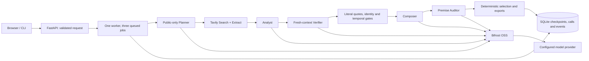

# DiscoveryBrief architecture

All source retrieval uses Tavily. All live inference uses the local Bifrost gateway.
Models submit bounded typed payloads; they cannot execute commands, choose file paths or
arbitrary tools. The Planner sees public fields only. RFP, notes and participants can reach
the configured inference provider through later roles, but cannot enter public queries.

`contracts.py` defines the public Brief/BriefBundle, sources, references, events, errors,
metrics and RunView. The selected one-page brief contains IDs into an approved ledger;
local evidence details retain all candidates, reviews, rejections and source snapshots.
`bundle.py` validates hashes, Unicode spans and reference integrity. The Verifier never
receives the Analyst's relevance reasoning. Model semantic verification can still be wrong.

SQLite is single-process and unencrypted. Short transactions update lifecycle/events and
stage checkpoints. Atomic files are served only through a completed run's manifest after
path/hash verification. On restart unfinished work becomes INTERRUPTED; it is never retried
automatically. Each run has a 300-second worker timeout including report publication.

HTML/Markdown/PDF use the same selected content. PDF rendering uses local system fonts,
blocks remote loads and keeps minimum body font size; deterministic pruning avoids overflow.
Full approved material remains in JSON/evidence. Rendering failure preserves HTML/MD/JSON.

Public-demo mode has a separate data directory and accepts only allowlisted synthetic replay.
It does not accept new paid research or expose the gateway. This is a local single-owner MVP,
not a multi-tenant service or a distributed queue.
